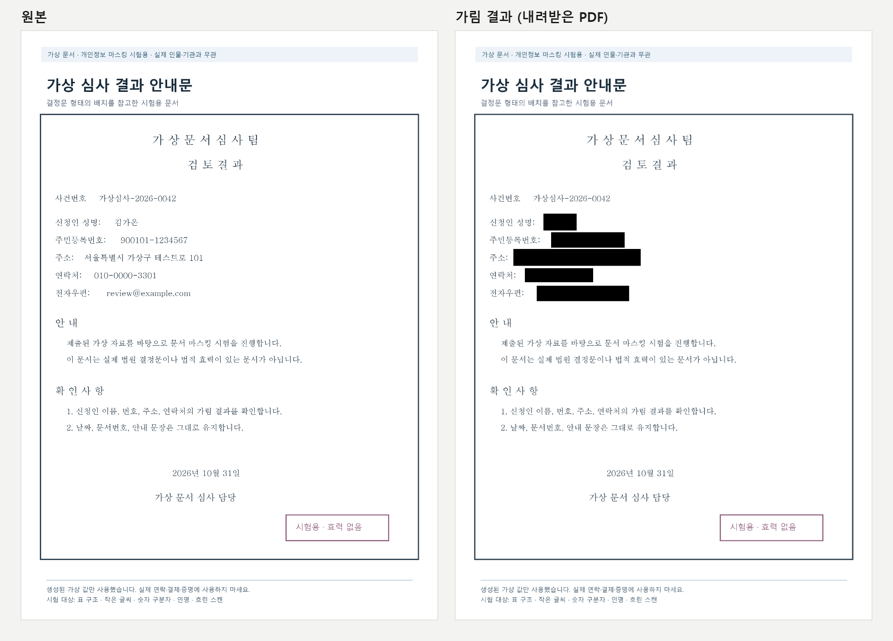
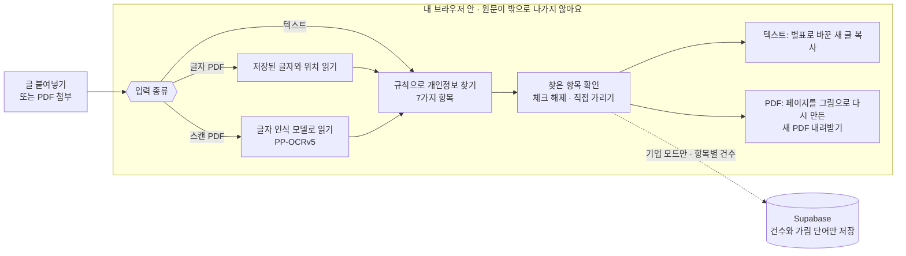
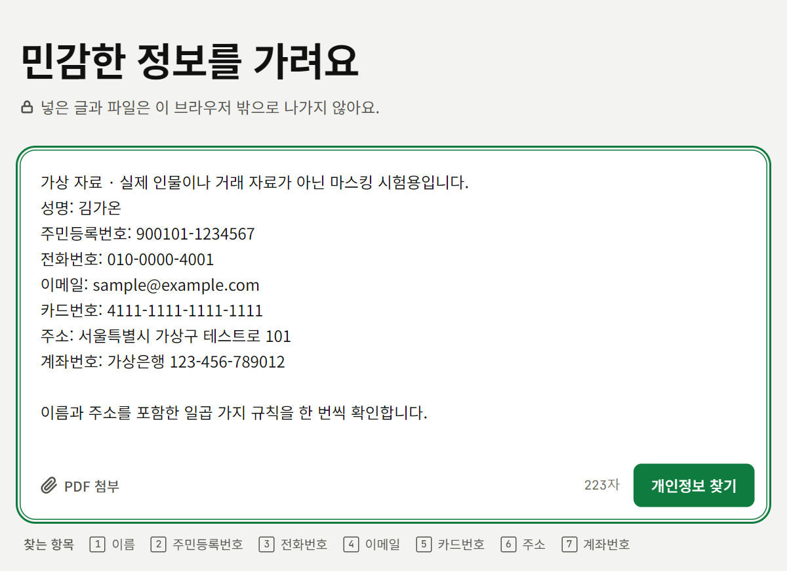
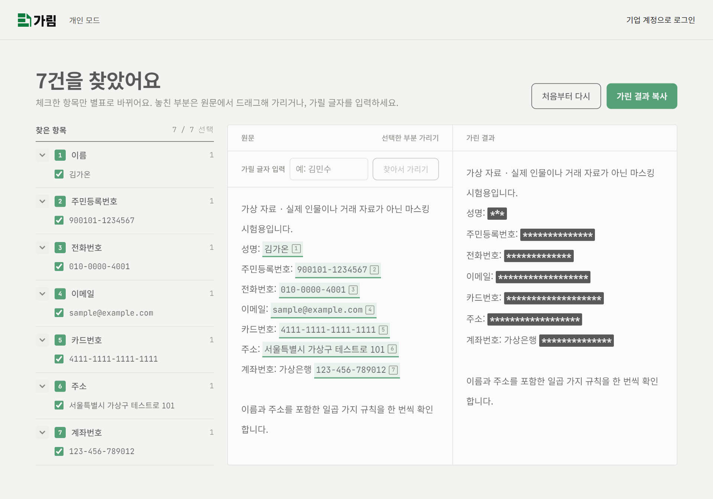
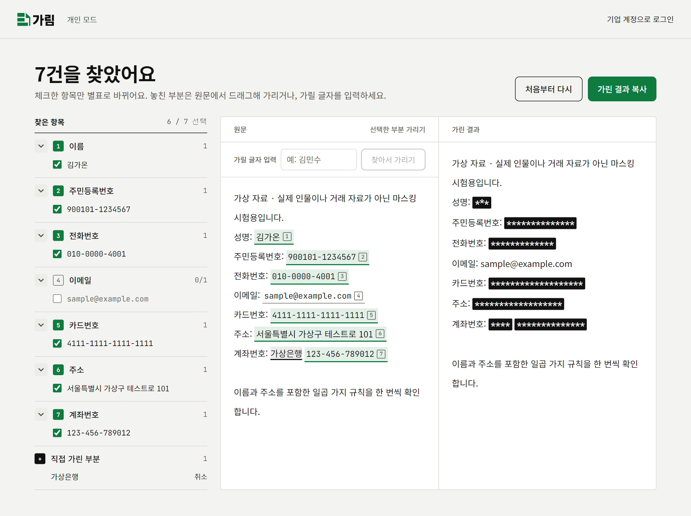
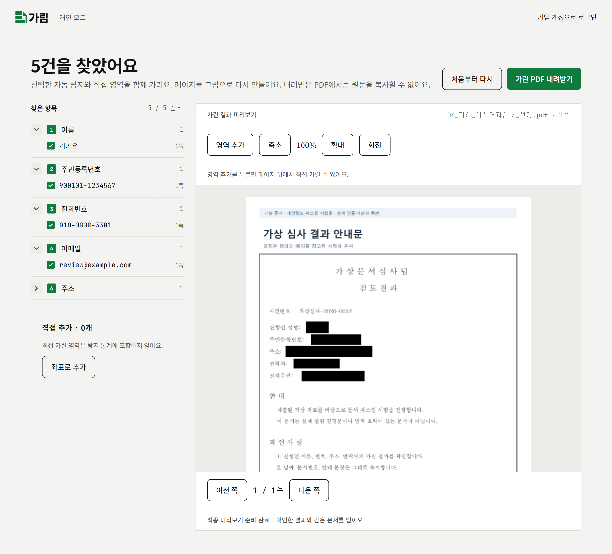

<div align="center">

# 가림

**PDF나 텍스트 속 개인정보를 브라우저 안에서 찾아, 복원할 수 없게 가리는 웹 서비스**

[서비스 바로가기](https://garim-26.vercel.app/) · [원본 저장소](https://github.com/sbychul/Garim) · 2026 「AI와 맞짱뜨는 밤」 해커톤 출품작



<sub>가상 스캔 문서를 넣었을 때의 실제 결과예요. 이름·주민등록번호·주소·연락처·이메일 5곳을 글자 인식으로 찾아 가렸어요.</sub>

</div>

## 한눈에 보기

- **원문은 서버로 가지 않아요.** 찾기, 가리기, 스캔 문서의 글자 인식까지 모두 지금 쓰는 브라우저 안에서 처리해요.
- **텍스트·글자 PDF·스캔 PDF를 모두 다뤄요.** 스캔 페이지는 브라우저에서 실행하는 한국어 글자 인식 모델(PP-OCRv5 경량)로 읽어요.
- **가린 결과는 되돌릴 수 없어요.** PDF는 검은 상자를 덮는 대신 페이지를 그림으로 다시 만들어서, 가린 아래의 글자를 복사해 낼 수 없어요.
- **개인과 기업 모두 쓸 수 있어요.** 개인은 로그인 없이 쓰고, 기업은 공통 가림 단어와 항목별 탐지 건수 통계를 써요.

## 이렇게 동작해요



### 원문은 내 브라우저 안에 있어요

- 붙여넣은 글과 첨부한 PDF는 서버로 보내지 않아요. 찾기와 가리기, 스캔 문서의 글자 인식까지 모두 지금 쓰는 브라우저 안에서 처리해요.
- 글자 인식 모델은 서비스 주소에서 브라우저로 내려받아 기기 안에서 실행해요. 원문을 외부 인식 서버에 보내지 않아요.
- 기업 모드에서 서버에 남는 것은 "누가, 언제, 어떤 항목에, 몇 건 걸렸는지"와 텍스트·PDF 구분뿐이에요. 원문, 파일, 찾은 실제 값(주민등록번호 자체 등)은 저장하지 않아요.
- 관리자도 내용은 볼 수 없고 사람 이름과 건수만 봐요. 개인 모드는 아무 기록도 남기지 않아요.

## 실제로 돌려본 예시

저장소의 [`samples/`](samples/) 폴더에 들어 있는 **가상 자료**로 개인 모드를 로컬에서 직접 실행해 기록했어요. 화면 속 이름과 번호는 모두 만든 값이에요.

### 1. 텍스트 붙여넣기

7가지 항목이 한 번씩 들어간 [통합 시연 글](samples/한국어/텍스트/00_전체규칙_통합시연.txt)을 붙여넣고 **개인정보 찾기**를 눌러요.



7건을 모두 찾았어요. 가운데 **원문**에서는 찾은 위치에 번호가 붙고, 오른쪽 **가린 결과**에서는 별표로 바뀌어요.



### 2. 가릴 항목을 직접 고르기

이메일은 체크를 꺼서 남기고, 자동으로 찾지 않는 은행 이름 `가상은행`은 **가릴 글자 입력 → 찾아서 가리기**로 추가했어요. 왼쪽 목록에 **직접 가린 부분**이 생기고 결과에 바로 반영돼요.



### 3. 스캔 PDF 가리기

글자 층이 없는 [가상 심사 결과 안내문](<samples/한국어/가짜 샘플(이미지O)/04_가상_심사결과안내_선명.pdf>)을 첨부했어요. 브라우저 안에서 글자 인식 모델이 페이지를 읽고, 찾은 항목을 미리보기에 바로 가려서 보여 줘요.



**가린 PDF 내려받기**로 받은 파일을 원본과 나란히 놓으면 맨 위 그림과 같아요.

### 확인한 결과

| 예시 | 찾은 항목 | 결과 확인 |
|---|---|---|
| 텍스트 (통합 시연 글) | 7 / 7건: 이름, 주민등록번호, 전화번호, 이메일, 카드번호, 주소, 계좌번호 | 가린 결과에 원래 값이 남지 않음 |
| 스캔 PDF (심사 결과 안내문, 1쪽) | 5 / 5건: 이름, 주민등록번호, 전화번호, 이메일, 주소 | 내려받은 PDF에서 5곳 모두 검게 가려짐. 분석 약 17초 (모델 첫 다운로드 포함) |
| 글자 PDF (신규 입사자 인사등록서, 1쪽) | 4건: 이름, 주민등록번호, 전화번호, 이메일 | 원본에서 뽑히던 글자 203자 → 내려받은 PDF에서 0자 |

<sub>2026-11-10에 윈도 크롬에서 개인 모드로 한 번씩 실행한 결과예요. 일반 문서 전체의 정확도를 보장하는 수치는 아니에요. 인사등록서 예시에서는 `가상사원 가온`처럼 라벨 뒤 이름이 4자를 넘으면 일부만 가려졌고, 시·도로 시작하지 않는 주소(`가상시 …`)는 찾지 못했어요. 아래 [이런 것은 찾지 못해요](#이런-것은-찾지-못해요)에 적힌 한계와 같아요. 이런 부분은 **영역 추가**로 직접 가려 주세요.</sub>

## 개인 모드와 기업 모드

| | 개인 모드 | 기업 모드 |
|---|---|---|
| 로그인 | 필요 없어요 | 관리자가 발급한 계정으로 로그인해요 |
| 가릴 항목 | 찾은 항목 중에서 직접 골라요 | 자동으로 찾은 항목은 모두 가려지고 해제할 수 없어요 |
| 기업 공통 단어 | 적용하지 않아요 | 관리자가 등록한 단어를 함께 가려요 |
| 직접 가리기 | 쓸 수 있어요 | 추가만 할 수 있어요 |
| 기록 | 남기지 않아요 | 마스킹 완료 시 항목별 건수만 기록해요 |

## 개인 모드 사용법

1. 첫 화면에서 **개인으로 사용하기**를 눌러요.
2. 입력창에 글을 붙여넣거나, **PDF 첨부**를 누르거나 PDF를 입력창에 끌어다 놓아요.
3. **개인정보 찾기**를 눌러요.
4. 결과 화면의 **찾은 항목**에서 가릴 항목을 골라요.
   - 처음에는 모두 선택되어 있어요. 체크를 끄면 그 항목은 가리지 않아요.
   - 항목 종류 앞의 번호를 누르면 그 종류를 한 번에 선택하거나 해제해요.
5. 놓친 부분은 직접 가려요.
   - 텍스트: **원문**에서 글자를 드래그한 뒤 **선택한 부분 가리기**를 누르거나, **가릴 글자 입력**에 글자를 적고 **찾아서 가리기**를 눌러요. 원문에 나오는 같은 글자를 모두 가려요.
   - PDF: **영역 추가**를 누르고 페이지 미리보기 위에서 가릴 영역을 사각형으로 지정해요. **좌표로 추가**로 위치를 숫자로 넣을 수도 있어요.
   - 직접 가린 부분은 **직접 가린 부분**, **직접 추가** 목록에서 다시 취소할 수 있어요.
6. 결과를 받아요.
   - 텍스트: **가린 결과**를 확인하고 **가린 결과 복사**를 눌러요. 가린 글자는 별표로 바뀌어요.
   - PDF: **가린 결과 미리보기**에서 내려받을 모습을 확인한 뒤 **가린 PDF 내려받기**를 눌러요. 파일 이름 끝에 `_가림`이 붙어요.
7. 새 문서를 처리하려면 **처음부터 다시**를 눌러요.

## 기업 모드 사용법

### 직원

1. 첫 화면의 **기업 계정으로 로그인**에 회사 이메일과 비밀번호를 넣어요. 계정은 관리자에게 받아요.
2. 개인 모드와 같이 글이나 PDF를 넣고 **개인정보 찾기**를 눌러요. 입력 화면 아래 **찾는 항목**에 공통 단어도 함께 표시돼요.
3. 자동으로 찾은 항목과 기업 공통 단어는 모두 **고정**으로 가려지고 해제할 수 없어요. 놓친 부분은 직접 가리기로 더 가릴 수 있어요.
4. 결과를 확인하고 **마스킹 완료**를 눌러요. 이때 자동으로 찾은 항목의 건수가 한 번 기록돼요.
5. 기록 처리가 끝나면 **가린 결과 복사** 또는 **가린 PDF 내려받기**를 쓸 수 있어요.
   - 기록 확인에 실패해도 가린 결과는 사용할 수 있어요. 이때는 기록되었는지 확인할 수 없다는 안내가 나와요.
   - 복사, 내려받기, 미리보기를 다시 만드는 것은 추가로 기록하지 않아요.
   - 직접 가린 부분과 0건인 항목은 기록하지 않아요.
6. 위쪽 메뉴의 **로그아웃**으로 나가요.

### 관리자

관리자도 직원과 똑같이 가리기 기능을 쓰고, 위쪽 메뉴의 **통계**에서 아래 두 화면을 볼 수 있어요.

- **탐지 통계**: 텍스트와 PDF를 합친 전체 기간 누적 건수예요.
  - 사람별 탐지 건수 순위 (같은 건수는 같은 순위)
  - 사람별·항목별 탐지 건수 표
  - 항목별 전체 합계
  - 기록이 없는 사람과 항목은 0으로 보여요. **다시 조회**로 최신 기록을 불러와요.
- **기업 가림 단어**: 회사에서 함께 가릴 단어나 문구를 추가하고 삭제해요.
  - 등록한 단어는 직원과 관리자의 텍스트·PDF 결과에 모두 강제로 적용돼요.
  - 부분 일치로 찾고 영문 대소문자는 구분하지 않아요. 한 단어는 100자까지예요.
  - 등록한 단어 자체는 서버에 저장돼요. 문서 원문은 저장하지 않아요.

관리자 화면에는 원문, 파일, 실제 개인정보가 나오지 않아요. 직접 가린 영역과 실행 횟수도 통계에 넣지 않아요. 통계는 처벌이 아니라 보안 교육 대상을 찾는 데 써 주세요.

## 찾는 개인정보

| 항목 | 찾는 형식 |
|---|---|
| 주민등록번호 | `900101-1234567`처럼 6자리-7자리이고 앞 6자리가 날짜 형식인 번호 |
| 전화번호 | `010-1234-5678` 같은 휴대전화 번호. 하이픈·공백·점으로 나누거나 붙여 쓴 형태 |
| 이메일 | 일반적인 이메일 주소 |
| 카드번호 | 4자리씩 나눈 16자리 번호 중 카드번호 검증(룬 체크섬)을 통과한 번호 |
| 이름 | "이름", "성명", "성함" 뒤에 오는 한글 2~4자. 라벨은 남기고 이름만 가려요 |
| 주소 | 시·도 이름으로 시작하는 도로명 주소나 지번 주소와 뒤의 동·호·층 |
| 계좌번호 | "계좌번호", "계좌" 뒤에 오는 숫자 10~14자리(하이픈 제외). 라벨과 은행 이름은 남겨요 |
| 공통 단어 | 기업 모드에서 관리자가 등록한 단어 |

### 이런 것은 찾지 못해요

- "홍길동 님"처럼 라벨이 없는 이름, 라벨이 없는 계좌번호
- 시·도를 생략한 주소, 아파트 이름 같은 자유 형식의 상세 주소
- 한 번호 안에서 구분 기호를 섞어 쓴 전화번호, 휴대전화가 아닌 일반 전화번호
- 큰따옴표로 감싼 이메일 아이디, 국제화 이메일 주소의 완전한 처리

자동 찾기는 정해진 형식만 확인해요. 모든 개인정보를 빠짐없이 찾는다고 보장하지 않으니, 결과를 꼭 눈으로 확인하고 놓친 부분은 직접 가려 주세요.

## 넣을 수 있는 파일

- **텍스트**: 입력창에 붙여넣은 글
- **글자 PDF**: 글자를 선택할 수 있는 PDF는 저장된 글자와 위치를 그대로 읽어요.
- **스캔 PDF·혼합 PDF**: 이미지가 있는 페이지는 브라우저 안의 한국어 글자 인식 모델(PP-OCRv5 경량)로 읽어요. 이미지가 없는 페이지는 저장된 글자를 읽어요.
- 한 파일은 **30메가바이트, 50쪽**까지예요.
- **이미지 파일(JPG, PNG 등)은 직접 첨부할 수 없어요.** PDF가 아닌 파일은 첨부를 막아요.

스캔 PDF를 처리할 때 알아 둘 점이에요.

- 처음 쓸 때는 글자 인식 모델을 내려받아서 시간이 걸릴 수 있어요. 진행 상황이 쪽 단위로 보이고 **처리 취소**로 멈출 수 있어요.
- 흐리거나 기울어진 글자, 손글씨, 작은 글자는 잘못 읽거나 놓칠 수 있어요. 가림 영역도 글자 경계와 정확히 맞지 않을 수 있어요.
- 읽지 못한 페이지는 개인정보 0건으로 표시하지 않고 따로 알려 줘요.

## 가린 결과는 되돌릴 수 없어요

- 텍스트는 가린 부분을 별표로 바꾼 새 글을 만들어요. 원래 글자가 결과에 남지 않아요.
- PDF는 검은 상자를 위에 덮지 않고, 가린 페이지를 그림으로 다시 만들어 새 PDF로 저장해요. 내려받은 PDF에서 글자를 복사해도 원문이 나오지 않아요. 대신 내려받은 PDF의 글자는 선택하거나 검색할 수 없어요.

## 직접 실행해 보기

```bash
npm install
npm run prepare:ocr   # 스캔 PDF용 글자 인식 모델 준비 (처음 한 번)
npm run dev
```

개인 모드는 로그인 없이 바로 쓸 수 있어요. 기업 모드에는 Supabase 설정이 필요해요. 개발 환경, 배포, 데이터베이스 설정은 [개발 문서](docs/development.md)를, 기능 명세와 데이터 약속은 [기능 명세서](docs/spec.md)를 확인해 주세요.
